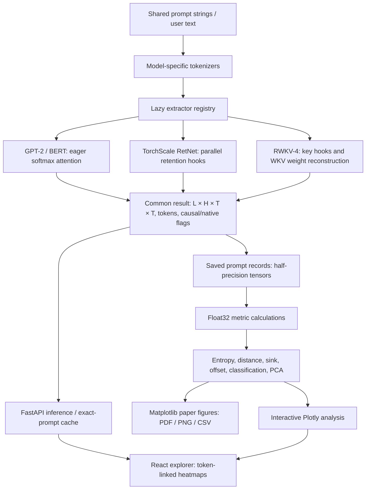

# AttentionLens: paper-writing reference

## Scope and contribution

AttentionLens extracts native attention or token-mixing analogues from GPT-2, BERT, TorchScale RetNet, and pretrained RWKV-4. It offers a common tensor interface, descriptive metrics, rule-based head classification, interactive exploration, dataset-level comparisons, and reproducible figure exports. The study compares checkpoint-specific patterns; it does not isolate architectural effects or explain predictions causally.

## System architecture



React is served from the same FastAPI origin. `/api/models` lists model availability; `/api/extract` returns attention, cumulative rollout, entropy, tokens and model flags. Exact saved prompts reuse tensors; new text invokes the model. `/api/analysis` supplies dataset metadata and `/api/analysis/{view}` serves interactive figures. Model instances and analysis data are cached. Mutable extractor hooks are protected by a lock during inference. RetNet availability depends on its checkpoint. API and frontend run locally on port 8501.

## Experimental design

- 32 manually authored English strings from configs/prompts.yaml, identical across models.
- Maximum extraction length 128 tokens. All measured saved lengths are below this limit.
- 12 layers and 12 heads/groups per model: 144 instances each, 576 total.
- CPU extraction in evaluation mode without gradient tracking.
- Saved tensors are float16; metrics cast to float32.
- Aggregate means weight prompts equally; population standard deviations measure prompt variation, not uncertainty of a population mean.

## Table 1: model configurations

| Model | Source | Extracted mechanism | Direction | Dimensions |
|---|---|---|---|---|
| GPT-2 | gpt2 | Native softmax attention | Causal | 12 layers × 12 heads; hidden width 768 |
| BERT | bert-base-uncased | Native softmax attention | Bidirectional | 12 layers × 12 heads; hidden width 768 |
| RetNet | checkpoints/retnet_128.pt | Signed parallel retention; absolute weights for metrics | Causal | 12 layers × 12 heads; embedding/value widths 768; FFN 3072 |
| RWKV-4 | RWKV/rwkv-4-169m-pile | WKV-derived token weights | Causal | 12 layers; 768 channels averaged into 12 contiguous groups of 64 |

RWKV's checkpoint name refers to the full language model; AttentionLens loads its backbone without the language-model output head. The full RWKV causal language-model class has 169,342,464 parameters; its extracted backbone has 130,729,728. The pseudo-head grouping is an analysis convention, not a native RWKV architectural feature. Parameter counts below count unique parameters in the instantiated classes used by extraction.

| Model | Extractor-model parameters | Saved token range |
|---|---:|---:|
| GPT-2 | 124,439,808 | 9–23 |
| BERT | 109,482,240 | 11–25 |
| RetNet (TinyStories) | 236,185,681 | 9–23 |
| RWKV-4 | 130,729,728 | 9–24 |

## RetNet training provenance

training_metadata.json records TinyStories (roneneldan/TinyStories), GPT-2 tokenizer, 100 optimizer steps, sequence length 128, batch size 1, accumulation 8, final training loss 4.5150 and validation loss 4.4345. Nominal processed training targets: 100 × 128 × 1 × 8 = 102,400 tokens, assuming every recorded step completed all microbatches. This is not a count of unique tokens. GPU model, seed, exact library versions, validation sample size and learning-rate schedule are not recorded in this metadata. The Colab code supplied earlier specified AdamW, LR 3e-4, weight decay 0.1 and betas (0.9,0.95), but confirm the executed notebook before presenting those as verified settings. Checkpoint inspection confirms value width 768, although the metadata omits that field.

## Metric definitions and the rollout qualification

For head metrics, p(i,j)=|A(i,j)| / sum_j |A(i,j)|. These probability-like values do not retain RetNet's sign.

- Entropy: -sum_j p log p / log(n_i), with n_i=i+1 for causal models and T for BERT. Average over queries; omit causal query zero. A one-token case returns zero.
- Relative distance: sum_(i,j) p(i,j)|i-j| / [T(T-1)]. Normalisation is token-relative, not word-relative.
- First-token mass: average p(i,0) over i≥1. BERT token zero is [CLS], not the first text token.
- Lookback offset: mean p(i,i-d) across valid query positions, heads and layers per prompt; average eligible prompts equally. d=0 includes self. Larger offsets can have fewer eligible prompts. Forward-looking BERT weights are excluded.
- Current rollout: M_l=mean_h |A_l,h|; B_l=RowNorm(M_l+I); R_l=B_l R_(l-1), R_(-1)=I. The implementation does NOT first normalise each head before averaging. For signed RetNet weights, input scale affects effective residual weight. Describe this exact procedure, or revise it and regenerate rollout figures before claiming a common fixed 50/50 mixture.

## Table 2: classification rules

| Priority | Type | Test on prompt-averaged score |
|---:|---|---|
| 1 | First token | Mean p(i,0), i≥1, ≥0.5 |
| 2 | Previous token | Mean p(i,i−1) over valid queries ≥0.5 |
| 3 | Next token | Mean p(i,i+1) over valid queries ≥0.5 |
| 4 | Self | Mean p(i,i) ≥0.5 |
| 5 | Local window | Mean row mass at |i−j|≤3 ≥0.7 |
| 6 | Broad | No earlier match and normalised entropy ≥0.8 |
| 7 | Other | No earlier match |

The first passing rule wins. Labels describe simple positional patterns, not demonstrated head function; induction, syntax and delimiter behaviour are not explicitly detected.

## Table 3: head-type counts and percentages

| Model | First | Previous | Next | Self | Local | Broad | Other |
|---|---:|---:|---:|---:|---:|---:|---:|
| GPT-2 | 73.61% (106) | 1.39% (2) | 0.00% (0) | 4.17% (6) | 10.42% (15) | 4.86% (7) | 5.56% (8) |
| BERT | 2.08% (3) | 1.39% (2) | 2.78% (4) | 0.00% (0) | 1.39% (2) | 6.25% (9) | 86.11% (124) |
| RetNet (TinyStories) | 0.00% (0) | 0.00% (0) | 0.00% (0) | 0.00% (0) | 31.25% (45) | 68.75% (99) | 0.00% (0) |
| RWKV-4 | 20.83% (30) | 4.86% (7) | 0.00% (0) | 14.58% (21) | 17.36% (25) | 30.56% (44) | 11.81% (17) |

## Table 4: overall metrics

Compute each prompt's average across layers and heads, then mean ± population SD across 32 prompts. Distance and sink entries are percentages; SD is in percentage points.

| Model | Normalised entropy | Relative distance (%) | First-token mass (%) |
|---|---:|---:|---:|
| GPT-2 | 0.4820 ± 0.0238 | 35.44 ± 1.12 | 62.61 ± 3.02 |
| BERT | 0.5335 ± 0.0188 | 37.88 ± 1.02 | 12.42 ± 1.09 |
| RetNet (TinyStories) | 0.8596 ± 0.0130 | 23.01 ± 0.56 | 16.00 ± 2.91 |
| RWKV-4 | 0.7451 ± 0.0209 | 25.84 ± 1.49 | 33.44 ± 3.62 |

## Table 5: final-layer metrics

These are layer 11 only, not the overall values above. Bands in Figures 2 and 5 use these per-layer prompt statistics.

| Model | Entropy, mean ± SD | First-token mass (%), mean ± SD |
|---|---:|---:|
| GPT-2 | 0.4726 ± 0.0495 | 67.38 ± 3.89 |
| BERT | 0.5526 ± 0.0670 | 3.19 ± 0.83 |
| RetNet (TinyStories) | 0.9373 ± 0.0119 | 17.79 ± 3.71 |
| RWKV-4 | 0.8103 ± 0.0401 | 31.69 ± 8.35 |

## Sensitivity results

Window held at ±3; each run shifts ALL thresholds together (including broad-entropy threshold). This is not a one-threshold-at-a-time experiment. Each model has 144 heads/groups.

| Model | Threshold delta | First | Previous | Next | Self | Local | Broad | Other |
|---|---:|---:|---:|---:|---:|---:|---:|---:|
| GPT-2 | -0.1 | 114 | 5 | 0 | 6 | 18 | 1 | 0 |
| GPT-2 | +0.0 | 106 | 2 | 0 | 6 | 15 | 7 | 8 |
| GPT-2 | +0.1 | 89 | 1 | 0 | 4 | 9 | 3 | 38 |
| BERT | -0.1 | 11 | 5 | 5 | 2 | 4 | 26 | 91 |
| BERT | +0.0 | 3 | 2 | 4 | 0 | 2 | 9 | 124 |
| BERT | +0.1 | 2 | 1 | 2 | 0 | 2 | 1 | 136 |
| RetNet (TinyStories) | -0.1 | 0 | 0 | 0 | 0 | 144 | 0 | 0 |
| RetNet (TinyStories) | +0.0 | 0 | 0 | 0 | 0 | 45 | 99 | 0 |
| RetNet (TinyStories) | +0.1 | 0 | 0 | 0 | 0 | 0 | 29 | 115 |
| RWKV-4 | -0.1 | 57 | 10 | 0 | 32 | 25 | 20 | 0 |
| RWKV-4 | +0.0 | 30 | 7 | 0 | 21 | 25 | 44 | 17 |
| RWKV-4 | +0.1 | 25 | 3 | 0 | 4 | 38 | 16 | 58 |

RetNet shifts from 144 local heads at lower thresholds, to 45 local/99 broad at baseline, to 29 broad/115 other at higher thresholds. Category conclusions are threshold-sensitive. Other tested windows are 1 and 5; all results are in outputs/metrics/sensitivity/results.json.

## Main figure index and writing guidance

| Figure | File stem | What it supports |
|---|---|---|
| 1 | figure_1_final_rollout | An illustrative comparison on the same sentence, indexed tokens and shared colour mapping; selected row percentages. Not a dataset average. |
| 2 | figure_2_entropy | Layer-wise entropy changes and prompt variation; final-layer summary. |
| 3 | figure_3_head_type_distribution | Percentages and counts for every classified type, including small/zero categories. |
| 4 | figure_4_relative_distance | Mean distance for each layer/head with every cell annotated and shared scale. |
| 5 | figure_5_first_token_mass | Layer-wise sink statistics with prompt bands and final-layer values. |
| 6 | figure_6_lookback_offset | Log-scale lookback curves plus numerical percentages and eligible prompt counts. |

All six have PDF, 400-dpi PNG and CSV files in outputs/paper_figures. A figure with a high entropy is not evidence of superior reasoning. A short attention distance is not evidence of inability to model long-range dependencies. The offset curves need not decay monotonically; GPT-2 and RWKV rise again at larger offsets on this prompt set.

Supplementary candidates already generated in outputs/figures: per-model layer snapshots, entropy_heatmap, head_type_map, offset_profile, distance_heatmap, sink_by_layer, head_atlas, entropy_bands. PCA uses 11 prompt-averaged features: offsets 0–5, ahead mass, entropy, first-token mass, local mass, relative distance; standardise over all heads, then SVD projection. Distinguish the PCA head atlas from the explorer's head-comparison grid.

## Limitations and appropriate claims

1. 32 manually authored, short English prompts do not establish broad generalisation. No long-context evaluation.
2. Models differ in training corpus, objective, tokenisation, parameter count and maturity. RetNet is an early TinyStories checkpoint, not a matched pretrained comparison.
3. Native softmax weights and derived analogues have different semantics. Signed retention magnitudes discard cancellation; RWKV WKV weights omit token shift, receptance and output projection.
4. Channel grouping is arbitrary. BERT special tokens complicate first-token comparisons.
5. Rollout is a descriptive proxy, with a scale-sensitive RetNet residual mixture in the current code.
6. Prompt SD bands are not confidence intervals. No statistical significance test or intervention has been conducted.
7. Head classifications are hand-thresholded and sensitive to choices. “Other” is limited rule coverage, not absence of meaningful behaviour.
8. Source/weights were downloaded or trained, but public code release, licence and hosting need confirmation before claiming an open-source release.

## Suggested paper structure

Abstract: toolkit contribution, 4 models/32 prompts/576 instances, 1–2 descriptive findings, scope caveat.
Introduction: comparison problem and toolkit goals.
Related work: native attention analysis, visualisation, recurrence/retention, WKV reconstruction, attention vs explanation.
Method: extractors, common tensor, exact normalisation/rollout, metrics, classification, PCA.
Setup: checkpoint identifiers and parameter counts, prompts, training provenance, precision and aggregation.
Results: Figures 1–6 with exact measurements and sensitivity table.
Discussion: checkpoint-specific differences, special-token effects, training confounds.
Limitations: the points above.
Reproducibility: repository/licence, configurations, model identifiers, RetNet metadata and checkpoint, version/environment record, scripts and CSV values.

## Reproduction commands

```sh
source .venv/bin/activate
export HF_HOME="$PWD/.cache/huggingface"
export MPLCONFIGDIR="$PWD/.cache/matplotlib"
python scripts/extract_all.py gpt2 bert retnet rwkv
python scripts/compute_metrics.py
python scripts/make_figures.py
python scripts/make_analysis_figures.py
python scripts/sensitivity.py
python scripts/make_paper_figures.py
python scripts/run_web.py
```
